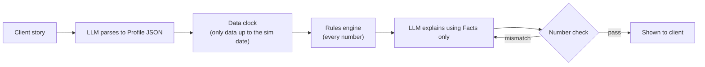

# ⚡ SPARK: Smart Portfolio Advisor for Retail Knowledge

> **Don't double down.** Your investments shouldn't bet on the same thing your paycheck does.

Built in one day by Bipindra, Prince and Faraaz (**Notting Hill Team 06**) at the **Microsoft x LSEG London Hackathon**, October 2026.

📊 **[Pitch deck (PDF)](docs/SPARK_pitch.pdf)**

*Educational hackathon project. Historical data and paper money only. Not financial advice.*

## The problem
In 2022, over 150,000 tech workers were laid off in the same year the Nasdaq fell about a third, so many people's income and savings were hit together. Retail investors face three linked problems:
- **Concentration:** savings sit in the same industry as the paycheck.
- **Panic-selling:** people sell in drops and lock in losses.
- **Untrustworthy AI:** chatbots invent numbers and change their answers.

## What SPARK does
| Feature | What it does |
|---|---|
| **Build** | Diversified portfolio that avoids the sectors the client's job already exposes them to |
| **Explain** | Every holding comes with its reason and sources |
| **Ask** | Plain-English Q&A about the portfolio |
| **Guard** | Coaches the client through drops instead of letting them panic-sell (the "time machine" replays 2022 to 2023 month by month) |
| **Autopilot** | An agent manages a capped, rule-bound slice (backend endpoint `/api/agent/step` only; there is no screen for it yet) |

### Example: Priya, 29, fintech engineer
$100k to invest, $15k already in tech-heavy QQQ, and a $30k house deposit due in 5 years. She says she's "high risk" but sold everything in March 2020. SPARK flags the contradiction and steps her down a risk level, halves her tech exposure, puts the $30k in Treasuries and coaches her through 2022. Replayed from 3 January 2022, she falls far less than the tech-heavy comparison and the deposit is untouched. In 2023 she lags behind, and SPARK shows that too.

Same $100k, different clients: **Tom** (41, NHS nurse) has a stable income, so he can take more equity risk. **Fiona** (35, offshore oil engineer) gets less energy exposure and a flag on her employer-share concentration.

## Code decides, the LLM only explains


- **No invented numbers:** every number in the LLM's text must match a Fact with a source and as-of date. If it doesn't, the explanation is regenerated (up to two retries), and if it still fails, a plain explanation written by code is shown instead.
- **No hindsight leakage:** `get_prices(tickers, as_of)` is the only way to read prices, and an assert stops future data slipping through. The LLM never predicts.
- **Prompt-injection resistant:** trades come only from an ETF whitelist, and the rules live in code, not in the prompt.

**Allocation rules** (`backend/engine/portfolio.py`): money for goals within 5 years goes in a safe bucket; risk level sets a 40/60, 60/40 or 80/20 equity/bond mix, stepped down a level if the profile contradicts itself; sectors that overlap the client's job are halved; no single ETF can exceed the 25% cap.

More detail: [architecture at three levels](docs/ARCHITECTURE.md), [data flow](docs/DATA-FLOW.md), [what is live and what is not](docs/LIVE-DATA.md). The app also has a `/how-it-works` page.

## Data sources
| Source | Used for |
|---|---|
| Yahoo Finance (via `yfinance`) | ETF prices (plain Close, not adjusted, to avoid future-dividend leakage) |
| FRED | Inflation and T-bill rates for the safe bucket |
| layoffs.fyi (public GitHub mirror of the tracker) | Which industries are shedding jobs |
| Hand-entered end-2021 sector weights | Approximate sector holdings of each ETF (a documented approximation, not live factsheets) |
| Client profile | Job, goals, holdings and past behaviour |

The CSVs are not in the repo: `backend/scripts/download_all.py` fetches them. Full provenance: [backend/data/SOURCES.md](backend/data/SOURCES.md).

## Tech stack
Next.js and TypeScript frontend · Flask (Python) backend · LLM through the organisers' Azure-hosted, OpenAI-compatible model portal (your own Azure OpenAI resource also works via env vars) · audit log in a local JSONL file, with an optional Azure Cosmos DB client that was not enabled at the event. [What Microsoft and Azure services are really used](docs/MICROSOFT-AZURE.md).

## Running locally
You need Python 3.14 or newer and Node.js 20 or newer.

**Mock mode (no keys, no data download).** Every endpoint returns fixed sample responses, so the whole UI works offline, but nothing is calculated for you.

```bash
# backend, terminal 1
cd backend
python3 -m venv .venv && .venv/bin/pip install -r requirements.txt
USE_MOCKS=1 FLASK_PORT=5070 .venv/bin/python app.py

# frontend, terminal 2
cd frontend
npm install
NEXT_PUBLIC_API_URL=http://localhost:5070 npm run dev -- -p 3000
```
Open http://localhost:3000.

**Real mode (live LLM and real price history).**
```bash
cp .env.example backend/.env                     # then fill in the LLM_* values
cd backend
.venv/bin/python scripts/download_all.py         # prices, FRED and layoffs CSVs into backend/data/
USE_MOCKS=0 .venv/bin/gunicorn -w 1 --threads 8 --timeout 60 -b 0.0.0.0:5070 app:app
```
Run the frontend as above. In real mode every feature (Build, Explain, Ask, the time machine with coach messages, Proof and the Autopilot endpoint) is calculated by the engine and the LLM.

**Tests:** `cd backend && .venv/bin/python -m pytest -q` (306 tests, including red-team cases for look-ahead leaks and prompt injection). Frontend checks: `cd frontend && npx tsc --noEmit && npm run lint && npm run build`.

## Beyond retail
The engine isn't tied to one client type. Swap the profile and the exposure map and the same pipeline could serve a small insurer. For example, a UK home insurer shouldn't also be heavy in UK property.

## Limitations & next steps
- Paper money and historical data only. A real launch would go through an FCA-authorised partner.
- Sector weights are hand-entered end-2021 approximations, not point-in-time data. ETFs are in USD (currency risk for UK clients). Only three personas have been tested.
- Prices aren't yet cross-checked against a second feed.
- Autopilot has no user interface yet.
- Next: LSEG data feeds, UK funds and ISAs, more job types.

## Team
- Bipindra Rai ([github.com/BipinJungRai](https://github.com/BipinJungRai))
- Prince ([github.com/Prince-Vijay-Santhosh](https://github.com/Prince-Vijay-Santhosh))
- Faraaz ([github.com/itsfaraazak](https://github.com/itsfaraazak))
